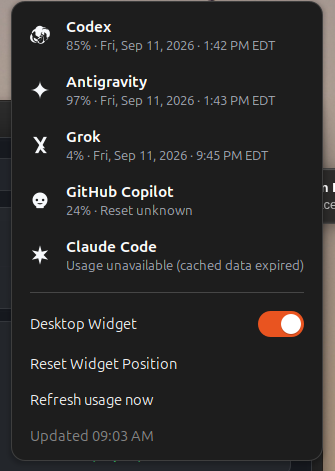

# Agent Meter

Agent Meter is a local Ubuntu/GNOME desktop widget for coding-agent quota
visibility. It shows a compact **icon for every configured provider** in the
top bar and an expanded, desktop-only card with separate five-hour and weekly
bars where the provider offers them.

The provider-specific symbols are bundled local SVGs: `codex`, `antigravity`,
`grok`, `copilot`, `claude`, and `generic`. They are lightweight UI symbols,
not downloaded artwork, and they never reveal account information. Every
provider configured in the daemon state appears both in the top bar and in the
expanded desktop card. The panel uses true `-symbolic.svg` variants plus a
high-contrast pill so the symbols remain visible on Ubuntu's black top bar.

## Screenshots

The compact top bar shows each provider's icon and remaining quota. Low quota
turns orange or red; unavailable usage appears as an em dash.


Open the provider menu for reset dates, refresh controls, each provider's
usage page, and desktop-widget settings. A usage item opens that provider's
`usage_url` in the default browser. These screenshots show version 0.1.6;
percentages are illustrative snapshots, not live usage.



## Design

```text
local adapter(s) -> agent-meterd (Rust) -> $XDG_RUNTIME_DIR/agent-meter/state.json
                                      |                    |
                                      |                    +-- GNOME extension: panel + desktop card
                                      +-- $XDG_STATE_HOME/agent-meter/state.json (stable JSON)
                                      +-- GTK desktop app (optional alternate surface)
```

The daemon binary is `agent-meterd`. The systemd user unit that runs it is
`agent-meter.service` (`systemctl --user restart agent-meter.service`).
`agent-meterd` only accepts a normalized, credential-free `ProviderState`
document from a fixed executable or local file. It never invokes a shell,
persists provider tokens, stores raw provider responses, or sends data off the
machine. Usage events are a separate local document and do not change
`state.json`. The optional ingest listener is off unless `--listen` is set,
and it does not dial out. The state file is atomically replaced, so the widget
never reads a partial result.

On GNOME Wayland there is no supported third-party window role that stays
behind every app window. The extension therefore owns the actual desktop card:
it is visible only when no application window has keyboard focus (for example
on an empty workspace or after showing the desktop), and it hides as soon as a
normal app gets focus. Drag the highlighted **Agent Meter** header to move it;
the saved position is clamped to the monitor so the card cannot be lost
off-screen. The top-bar row is always available.

Press **Super+Alt+U** to show or hide the widget, even over an active app.
Switching focus to another app restores desktop-only visibility. Drag the
**Agent Meter** header to reposition it. The provider menu's **Desktop Widget**
switch, and this shortcut, are saved in
`$XDG_CONFIG_HOME/agent-meter/position.json` (usually
`~/.config/agent-meter/position.json`) and restored when the extension starts.
The top bar stays available while the card is hidden.

## JSON output (`--json`) and stable state file

`agent-meter --json` prints the merged provider state to stdout in a stable,
documented JSON format. The daemon also atomically writes this JSON to
`$XDG_STATE_HOME/agent-meter/state.json` (defaults to
`~/.local/state/agent-meter/state.json`) on every refresh. This path survives
reboots, unlike the runtime state under `$XDG_RUNTIME_DIR`.

**Schema version 1** — the `schema_version` field will only increment when
breaking changes are made.

```json
{
  "schema_version": 1,
  "providers": [
    {
      "provider": "codex",
      "windows": [
        {
          "name": "five_hour",
          "remaining_percent": 72.0,
          "resets_at": "2026-09-16T22:00:00+00:00"
        },
        {
          "name": "weekly",
          "remaining_percent": 51.0,
          "resets_at": "2026-09-20T14:00:00+00:00"
        }
      ],
      "updated_at": "2026-09-16T20:45:00+00:00",
      "available": true,
      "stale": false
    },
    {
      "provider": "grok",
      "windows": [
        {
          "name": "weekly",
          "remaining_percent": 45.0,
          "resets_at": "2026-09-20T01:45:30+00:00"
        }
      ],
      "updated_at": "2026-09-16T20:45:00+00:00",
      "available": true,
      "stale": true
    }
  ]
}
```

| Field | Type | Description |
| --- | --- | --- |
| `schema_version` | `int` | Always `1` for this schema revision. |
| `providers[].provider` | `string` | Lowercase provider identifier (e.g. `codex`, `grok`, `muse`). |
| `providers[].windows[].name` | `string` | Stable window name: `five_hour`, `weekly`, `session`, `monthly`, etc. |
| `providers[].windows[].remaining_percent` | `float?` | Remaining quota from 0.0 to 100.0. Omitted when the probe could not run. Omission is not 0% remaining. |
| `providers[].windows[].resets_at` | `string?` | ISO 8601 datetime with timezone offset. Absent when the provider does not report a trustworthy reset time. Copilot is excluded from the expectation that every window has this field: the Copilot SDK `account.getQuota` returns `resetDate` equal to the fetch time, so no trustworthy reset instant exists. |
| `providers[].updated_at` | `string` | ISO 8601 timestamp of the last successful refresh. |
| `providers[].available` | `bool` | `false` only when the provider status is `unavailable` or `error`. Fresh and stale providers are available. |
| `providers[].stale` | `bool` | `true` only when the provider status is `stale`. Unavailable providers are not stale. |
| `providers[].reason` | `string?` | Machine-readable cause when no quota sample exists, for example `cli_not_installed`. Absent for a normal reading, including a real 0% remaining. |
| `providers[].windows[].forecast` | `object?` | Quota-exhaustion forecast (see below). Absent when forecasting is disabled or no history exists yet. |

## Quota forecasting

The daemon can keep a bounded, credential-free local usage history and
forecast whether a quota will run out before its reset. Forecasting is
**opt-in** via the `forecast` section of `sources.json`:

```json
{
  "refresh_seconds": 300,
  "forecast": {
    "enabled": true,
    "notify_thresholds": [25.0, 10.0, 5.0]
  },
  "sources": []
}
```

| Field | Default | Description |
| --- | --- | --- |
| `enabled` | `false` | Record usage history and compute forecasts. |
| `max_observations_per_window` | `288` | Cap on stored observations per provider window (~24 h at 5-minute cadence). |
| `stale_after_seconds` | `600` | Newest observation older than this marks the forecast `stale`. |
| `notify_thresholds` | `[]` | Remaining-percent thresholds that trigger a notification, e.g. `[25.0, 10.0, 5.0]`. Empty disables notifications. |
| `history_path` | `$XDG_STATE_HOME/agent-meter/usage-history.json` | Override for the history file. |
| `notifications_path` | `$XDG_STATE_HOME/agent-meter/notifications.jsonl` | Override for the notifications log. |

Each refresh records one observation per `fresh` provider window: a
timestamp, the remaining percentage, and the provider-supplied reset time.
Nothing else is stored — no credentials, no raw provider payloads. An upward
jump of 25 percentage points is treated as a quota reset and starts a fresh
cycle, dropping older observations.

Forecasts fit a line through the most recent observations and extrapolate to
zero remaining, then compare against the provider's reset time:

| `forecast.status` | Meaning |
| --- | --- |
| `ok` | Usable forecast; `estimated_exhaustion_at` is set when the quota is depleting, `exhausts_before_reset` compares it with `resets_at`. |
| `insufficient_data` | Fewer than 3 observations, or they span less than 5 minutes. |
| `stale` | The newest observation is older than `stale_after_seconds`; no guess is made. |
| `uncertain` | A trend exists but the linear fit is too noisy (R² < 0.5) to trust. |

`agent-meter --json` attaches the forecast to each window when history is
available:

```json
{
  "name": "five_hour",
  "remaining_percent": 70.0,
  "resets_at": "2026-10-14T22:00:00+00:00",
  "forecast": {
    "status": "ok",
    "estimated_exhaustion_at": "2026-10-14T20:00:00+00:00",
    "exhausts_before_reset": true,
    "consumption_rate_percent_per_hour": 10.0,
    "depleting": true,
    "observation_count": 12
  }
}
```

Notifications fire once per threshold per quota cycle (duplicate suppression):
when remaining drops at or below a threshold, the daemon appends a JSON line
to `notifications.jsonl` and logs a one-line summary to stderr. A quota reset
clears the suppression records so the next cycle notifies again.

## Usage events

Quota percentages and token usage are different documents. `state.json` stays
schema version 1. Session tokens, cache, cost, and duration live in the usage
store under `$XDG_STATE_HOME/agent-meter/` (usually
`~/.local/state/agent-meter/`).

This is the contract for the shared reporter and the per-harness hooks
(Josh-Archer/agent-setup#140 and #141–#143). Those reporters are not part of
this repository. They should send only the fields below.

### Privacy

The validator rejects unknown keys, including nested ones. Do not send a
prompt, message, tool input or output, diff, transcript, or a file path
inside a repo. `repo` is an `owner/name` slug or null. `source` is a short
tag such as `hook:Stop+transcript`, not the transcript itself. The store
keeps the normalized event and nothing else: no raw provider payloads and no
bearer tokens.

### Event schema v1

The normative JSON Schema is
[data/usage-event.v1.json](data/usage-event.v1.json). `schema` is
`agent-meter.usage-event/v1`. Every field is required. Use `null` when a
count or timestamp is unknown. Unknown is not `0`. `0` means the harness
reported zero.

`input_tokens` excludes cache read and cache write. Codex, Cursor, and
Copilot count cache inside input; Claude does not. Normalize on the reporter
side before sending.

Counts are cumulative totals for the session, not deltas. Each new snapshot
uses the next `seq`. The store keeps the highest `seq` for
`(host, harness, session_id)`, so a repeated Stop hook does not double count.

`idempotency_key` is the lowercase hex SHA-256 of the UTF-8 string

```text
host|harness|session_id|seq
```

`seq` is decimal with no leading zeros (`0` stays `0`). `host`, `harness`,
and `session_id` do not contain `|`.

```json
{
  "schema": "agent-meter.usage-event/v1",
  "idempotency_key": "613f7836ad7edd362b9853998dfda601c875355a2cfb180fcbc1ca2258634204",
  "kind": "session_snapshot",
  "host": "homelabdesktop",
  "harness": "claude",
  "harness_version": "2.1.321",
  "session_id": "uuid-or-native-id",
  "seq": 7,
  "observed_at": "2026-11-11T21:41:00-05:00",
  "started_at": "2026-11-11T21:40:15-05:00",
  "ended_at": null,
  "duration_ms": 45000,
  "models": [
    {
      "model": "claude-opus-5-5",
      "input_tokens": 1200,
      "output_tokens": 340,
      "cache_read_tokens": 80,
      "cache_write_tokens": 0,
      "reasoning_tokens": null,
      "requests": 2,
      "cost_usd": null,
      "cost_source": "none"
    }
  ],
  "source": "hook:Stop+transcript",
  "dispatch_run_id": null,
  "repo": null
}
```

| Field | Rule |
| --- | --- |
| `kind` | `session_snapshot` only in v1. |
| `host` | 1–128 of `A-Za-z0-9._-`. HTTP auth requires this to match the token's host id. |
| `harness` | Lowercase id: `claude`, `codex`, `agy`, `grok`, `muse`, `omp`, `copilot`, `cursor`, `gemini`. |
| `harness_version` | CLI version, or `unknown`. Do not omit it. |
| `session_id` | Stable harness session id. Not a filesystem path. |
| `seq` | Integer ≥ 0. Bump it when the cumulative totals change. |
| `observed_at` | RFC3339 with a numeric offset. |
| `started_at`, `ended_at`, `duration_ms` | RFC3339 or integer milliseconds, or `null`. |
| `models` | The full model list for the session so far, at most 64 rows, one row per model id. |
| `models[].input_tokens` and the other counts | Integer ≥ 0, or `null`. `input_tokens` excludes both cache fields. |
| `cost_usd` | Non-negative USD, or `null`. |
| `cost_source` | `harness` or `estimated` when `cost_usd` is a number. `none` when `cost_usd` is `null`. |
| `dispatch_run_id` | Dispatch run id, or `null`. Not a path. |
| `repo` | `owner/name` or a single segment, or `null`. |

A body may be one event or `{"events":[...]}` with at most 100 events. The
whole body must be at most 256 KiB. One invalid event rejects the whole body
and stores nothing.

### Transports

Both transports use the same validator and store. The listener is off by
default. Inbox drain does not require it.

**Local spool.** The reporter atomically renames a `*.json` file into
`$XDG_STATE_HOME/agent-meter/inbox/` (write a temporary file in the same
directory, then rename it). `agent-meterd` drains that directory on every
refresh and, when inotify is available, as soon as a file is renamed or
closed. Valid files move to `processed/`. Invalid files move to `rejected/`
with a sibling `.reason` file. Dotfiles and names that do not end in `.json`
are left alone. Each directory keeps at most 1024 archived files.

**Optional HTTP.** Remote hosts (for example mac-worker to homelabdesktop)
use `agent-meterd --watch --listen <tailnet-ip>:<port>`. The address must be
a literal IP. `0.0.0.0` and `::` are refused unless `--listen-any` is also
passed. The process refuses to listen when the token file is missing.

| Request | Result |
| --- | --- |
| `POST /v1/usage/events` | `202 {"accepted":n,"duplicates":m}` when the body is valid. `400 {"error":...}` on a schema or size error. `401 {"error":"unauthorized"}` on a bad or mismatched token. |
| `GET /v1/usage/healthz` | `200 {"ok":true}` with no auth, for reporter backoff. |

`Content-Length` is required on `POST`. Chunked bodies are not accepted.

### Auth

`Authorization: Bearer <token>`. The daemon reads
`$XDG_CONFIG_HOME/agent-meter/ingest-tokens.json` (usually
`~/.config/agent-meter/ingest-tokens.json`). The file maps `host` to the
lowercase hex SHA-256 of the token. It must not contain the token.

```json
{
  "schema": "agent-meter.ingest-tokens/v1",
  "hosts": {
    "homelabdesktop": "<64 lowercase hex chars>"
  }
}
```

Compute a hash with `printf '%s' "$TOKEN" | sha256sum`. Tokens live in
Vaultwarden, one item per host, and are provisioned by agent-setup. Every
event in the request must use the host id that matches that hash. A token for
host A presented with host B is `401`. No token value belongs in git, issues,
or this file. Mode `0600` is appropriate. `--ingest-tokens` overrides the path.

### Storage and reads

Accepted events append to `usage-events.jsonl`. A rollup index,
`usage-index.json`, keeps the latest snapshot per session. Readers use the
index, so a superseded `seq` is not added again. The log is compacted back to
those snapshots once it passes 8192 lines. The index keeps at most 2048
sessions and drops anything older than 30 days. That is the same kind of cap
as quota forecast history.

```bash
agent-meter usage --json
agent-meter usage --json --since 24h
agent-meter usage --json --since 24h --by harness
agent-meter usage --json --by model
agent-meter usage --json --by host
```

`--since` takes `30s`, `15m`, `24h`, `7d`, `2w`, or an RFC3339 timestamp.
Without it, the command returns every snapshot still inside the retention
window. The output schema is `agent-meter.usage-report/v1`:

```json
{
  "schema": "agent-meter.usage-report/v1",
  "generated_at": "2026-11-12T16:00:00Z",
  "since": "2026-11-11T16:00:00Z",
  "group_by": "harness",
  "sessions": 1,
  "totals": {
    "input_tokens": 1200,
    "output_tokens": 340,
    "cache_read_tokens": 80,
    "cache_write_tokens": 0,
    "reasoning_tokens": null,
    "requests": 2,
    "cost_usd": null,
    "duration_ms": 45000
  },
  "groups": [
    {
      "key": "claude",
      "sessions": 1,
      "totals": { "input_tokens": 1200, "output_tokens": 340 }
    }
  ]
}
```

`totals` sums the latest snapshot of each session. A null count is skipped,
not treated as zero. If every value for a field is null, the total is null.
If some are null and some are numbers, the total is the sum of the numbers
and the field name is listed in `incomplete`. Summing `groups` by harness or
host matches `totals`. A session with two models appears in two model groups;
`totals.sessions` still counts that session once. Model groups omit
`duration_ms`, because duration belongs to the session, not to a model.

On each refresh the daemon also writes `usage-today.json` (schema
`agent-meter.usage-today/v1`) next to the usage store and under
`$XDG_RUNTIME_DIR/agent-meter/`. The desktop card shows its `label` only when
`day` is today in the local timezone, for example
`Today: 1,200 in · 340 out · 1 session`. No file, an empty label, or a
previous day leaves the card unchanged.

### What reporters must do

- Send `session_snapshot` v1 with cumulative totals and a `seq` that increases when those totals change.
- Set `idempotency_key` to `sha256(host|harness|session_id|seq)` as specified above.
- Use `null` for counts the harness did not report. Do not invent `0`.
- Subtract cache read and cache write from input when the harness includes them in input.
- Set `cost_source` to `none` unless the harness or an estimator produced `cost_usd`.
- Put files in the inbox with an atomic rename, or `POST` one event or a batch to `/v1/usage/events`.
- On HTTP, send the bearer token for that host and set `host` to the same id. Use `GET /v1/usage/healthz` to decide when to back off.
- Keep the failure local. A rejected event must not block the harness.

To change the shortcut after package installation:

```bash
gsettings --schemadir /usr/share/gnome-shell/extensions/agent-meter@local/schemas \
  set org.gnome.shell.extensions.agent-meter toggle-widget "['<Super><Alt>u']"
```

After an extension JavaScript update, log out and back in to load the new code.

## Resource use

Provider polling remains every five minutes by default. The GNOME extension
checks local state every 15 seconds, but preserves its existing actors when
the data and display state are unchanged. New data, update timestamps, and
manual-refresh state still trigger rendering. Active drags defer rendering.

The Rust daemon is small; external provider CLIs can use substantially more
memory temporarily. A single sequential measurement on an Ubuntu desktop
(September 12, 2026) produced these GNU `time` maximum-RSS results:

| Adapter | Peak RSS | Elapsed |
| --- | ---: | ---: |
| Codex | 119 MiB | 0.60 s |
| Antigravity | 178 MiB | 5.07 s |
| Grok / OMP | 226 MiB | 0.97 s |
| Copilot | 54 MiB | 0.71 s |
| Claude cached state | 14 MiB | 0.02 s |

These are single-run process high-water marks, not simultaneous process-tree
totals or guaranteed budgets. CLI versions and caches affect the results.
The extension shares GNOME Shell's process, so Shell's total RSS is not the
widget's own memory usage. Systemd service memory also includes reclaimable
filesystem cache.

For a local adapter measurement without exposing provider output:

```bash
profile=$(mktemp)
/usr/bin/time -o "$profile" -f 'peak_rss_kib=%M elapsed_s=%e exit=%x' \
  timeout 60 agent-meter-adapter grok >/dev/null 2>/dev/null
cat "$profile"
```

## Progressive Quota Color Scale

Agent Meter uses a continuous, high-contrast color scale to convey remaining quota across all GNOME Shell and GTK surfaces:

| Remaining Quota | Visual Color | Hex Stop | Purpose |
| ---: | --- | :---: | --- |
| **> 40%** | Stable Green | `#38d472` | Normal operational headroom |
| **~30%** | Yellow | `#f6c445` | Usage threshold reached |
| **~20%** | Vivid Orange | `#ff8833` | Quota drawing down |
| **~10%** | Red-Orange | `#ff6644` | Approaching quota exhaustion |
| **0%** | Clear Red | `#ff3b56` | Quota exhausted |
| **Stale / Offline** | Neutral Slate | `#8b949e` | Unchanged cached state |

### Accessibility & Contrast Invariants
* **Dual Indicator**: Numeric percentages are always rendered alongside colors so color vision deficiency does not impede usage tracking.
* **High Foreground Contrast**: All chosen color stops maintain strong contrast (>4.5:1 WCAG AA) against Ubuntu's black top bar (`#000000`) and the dark desktop widget background (`#161920`).
* **Neutral Inactive State**: Stale or disconnected providers remain neutral gray (`#8b949e`) rather than mapping onto the warning/critical spectrum.

## Install on Ubuntu

The packaged release targets Ubuntu 24.04 on `amd64` with GNOME Shell 46.

### Standard APT Repository Installation

Install the cryptographic signing key and add the official Agent Meter repository:

```bash
curl -fsSL https://josh-archer.github.io/agent-meter/agent-meter-archive-keyring.gpg \
  | sudo tee /usr/share/keyrings/agent-meter-archive-keyring.gpg >/dev/null

echo "deb [arch=amd64 signed-by=/usr/share/keyrings/agent-meter-archive-keyring.gpg] https://josh-archer.github.io/agent-meter stable main" \
  | sudo tee /etc/apt/sources.list.d/agent-meter.list >/dev/null

sudo apt update
sudo apt install agent-meter
agent-meter-setup
```

### Manual Package Installation

Alternatively, download the `.deb` directly from the [latest Agent Meter release](https://github.com/Josh-Archer/agent-meter/releases/latest) and install it:

```bash
sudo apt install ./agent-meter_*_amd64.deb
agent-meter-setup
```

### Setup and Verification

`apt` installs the `agent-meterd` binary, the GTK surface, provider adapters,
the systemd user unit `agent-meter.service`, and the GNOME extension.
`agent-meter-setup` then creates `~/.config/agent-meter/sources.json`, installs
GitHub's pinned Copilot SDK in your user data directory, enables
`agent-meter.service`, and enables the extension.
It never copies provider credentials into the package or repository.

Log out and back in once so GNOME Shell discovers the extension, then verify
the installation:

```bash
systemctl --user status agent-meter.service
systemctl --user restart agent-meter.service
gnome-extensions info agent-meter@local
```

`agent-meter.service` is the user unit. It starts the `agent-meterd` binary.
Restart that unit; there is no `agent-meterd` unit.

To update through standard system package management:

```bash
sudo apt update && sudo apt upgrade
```

To remove the installed package:

```bash
systemctl --user disable --now agent-meter.service
sudo apt remove agent-meter
```

The release also includes a filesystem tarball for inspection and manual
packaging workflows. Most Ubuntu desktop users should choose the `.deb`.

## Build from source

### Build prerequisites

Source builds need these development dependencies before the GTK application
can compile:

```bash
sudo apt install libgtk-4-dev build-essential pkg-config
curl --proto '=https' --tlsv1.2 -sSf https://sh.rustup.rs | sh
```

Restart the terminal after installing Rust. The GNOME extension itself needs
only the already-installed GNOME Shell and GJS. The Rust daemon and core tests
do **not** need GTK4 headers.

### Build and install locally

From this directory:

```bash
cargo test
./install.sh
```

GNOME Shell only discovers newly copied user extensions when it starts. Log
out and back in once after the first install, then verify with
`gnome-extensions info agent-meter@local`. Run `agent-meter` only if you want
a normal movable GTK window as well; the GNOME-managed desktop card is the
default desktop-only surface.

## Connect providers

Copy [data/sources.example.json](data/sources.example.json) to
`~/.config/agent-meter/sources.json`, then point each source at a small local
adapter. An adapter must write exactly one JSON object matching
[data/provider-state.example.json](data/provider-state.example.json) to
standard output. `kind: "file"` accepts the same object from a local file.

The daemon marks an adapter as unavailable instead of deleting the provider if
the program is missing or returns malformed JSON. A provider state must use a
unique lowercase `id`, one of the bundled `icon` values (or it falls back to
`generic`), and one or more windows. Use `status: "fresh"`, `"stale"`,
`"unavailable"`, or `"error"` to make data quality visible in the UI.

Sources refresh independently, up to `max_concurrent_refreshes` at once
(default 4). Each command keeps its own timeout (`command_timeout_seconds`,
default 30). The wave also stops at `refresh_deadline_seconds` (default 45),
so several slow adapters do not add their delays together. A provider that
finishes is written immediately. One that misses the deadline, or fails after
a previous success, keeps that last good snapshot: `status` becomes `stale`,
the usage windows stay, and `updated_at` remains the time of the last success.

### Visual states and provider marks

Each provider uses a bundled, high-contrast monochrome vector replica of its
recognizable product mark. These are local UI identifiers, not vendor-provided
brand assets or an endorsement by the respective providers. While a manual
refresh is running, the top bar shows an animated spinner. A provider command
failure is shown as a muted gray icon and `-`; stale data instead keeps its last
known percentage so it is not mistaken for a sign-in failure.

### Claude Code

Claude Code exposes rate limits through its status-line JSON. Configure its
`statusLine` command in your Claude Code settings to point at the bundled helper:

```json
{
  "statusLine": {
    "type": "command",
    "command": "/home/you/.local/bin/agent-meter-claude-statusline"
  }
}
```

If you already have a custom status-line wrapper, pipe its JSON output to this
command or call it from within the wrapper. The helper reads JSON on stdin and
atomically writes `~/.local/state/agent-meter/claude.json`. It retains no raw
status-line input and no credentials. Once at least one payload has been received,
`agent_meter_adapter.py claude` reads that file and emits a normalized state.
Before the first payload arrives, the adapter returns `status: "unavailable"` with
instructions pointing back to this setup step.

### GitHub Copilot

GitHub Copilot uses the official Copilot SDK's `account.getQuota` RPC. It reports
the authenticated user's entitlement, consumed requests, remaining percentage,
and reset date directly, so no hand-entered allowance is required. `install.sh`
keeps the SDK and its matching Copilot CLI runtime under
`~/.local/share/agent-meter/copilot-sdk`.

The **Connect** action launches that provider-owned Copilot CLI. Enter `/login` in
the terminal if it is not already authenticated. Agent Meter never receives or
reads the OAuth credential; the SDK runtime uses the system keychain.

Copilot windows do not include `resets_at`. `account.getQuota` returns
`resetDate` equal to the fetch time, so that timestamp is not a quota reset.
The window's reset label is `Reset unknown`. Copilot is excluded from the rule
that every provider window carries an ISO 8601 `resets_at`.

### Antigravity

Antigravity quota is read directly from the provider-owned command
`agy -p /usage --output-format json`. It queries the internal language server's
`PredictionService.RetrieveUserQuotaSummary` RPC cache and returns the real
five-hour and weekly remaining fractions and reset times without reading OAuth storage.
The **Connect** button launches `agy` so its browser sign-in can complete.

Antigravity exposes separate quota pools for distinct model families, reported
as stable window identifiers:

* **General Gemini models** (`gemini-models-weekly`, `gemini-models-5h`):
  Covers Gemini Flash models (including **Gemini 3.8 Flash** High, Medium, and Low)
  and Gemini Pro models.
* **Claude and 3P models** (`claude-models-weekly`, `claude-models-5h`):
  Covers Claude Opus 5.5, Claude Sonnet 5.5, and GPT-OSS via agy.
* **Gemini 4 Argon** (`gemini-argon-weekly`, and `gemini-argon-5h` if present):
  A separate dedicated quota pool available on Google AI Pro and Ultra plans.

If a pool cannot be read, is disabled, or is not provisioned for the current
account tier, it is omitted rather than fabricated. Windows preserve provider-reported
`remaining_percent` and `resets_at` timestamps. Optional filtering to a single
group is available by setting `AGENT_METER_AGY_GROUP`.

### Grok

When OMP is installed and signed in, Agent Meter polls its OAuth usage report
and displays only **Shared weekly** credits. Product-specific Build, Imagine,
and Chat quotas are not substituted for this shared pool. Low and exhausted
quotas remain visible as valid percentages, including 0%, rather than being
treated as connection failures. OMP manages its own session refresh; Agent
Meter never reads its credential store. That report is live, so the adapter
stamps it with the fetch time and does not judge its age from a payload clock.

Without a usable OMP report, the Grok Build log path runs on its own and does
not depend on OMP. Grok Build writes a structured weekly billing snapshot to
`~/.grok/logs/unified.jsonl` when its CLI starts a session. On the shell
route, `grok usage` does not fetch that snapshot; only session startup does,
which is why leaving the TUI closed used to leave the reading stale after 30
minutes. The adapter reads only records named `billing: fetched credits config`
and keeps the newest snapshot, including one whose billing period has already
ended. It never opens `~/.grok/auth.json` or reads tokens, identity, prompts,
or model output.
The provider's `creditUsagePercent` field is usage consumed, so Agent Meter
converts it to the remaining percentage shown in the widget.
Staleness uses that record's own `ts`. When the newest snapshot is missing,
older than 30 minutes, or from a billing period that has ended, the adapter
starts `grok --no-alt-screen` on a private PTY (working directory
`$XDG_STATE_HOME/agent-meter/grok-billing-refresh`), waits until a newer
billing record is appended, then stops that process. It does not leave the
TUI running. If startup does not append a newer snapshot, the last known
percentage stays visible with status `stale` and a detail that includes the
age or the ended period. A reset instant already in the past is omitted.
You can tune the age boundary with `AGENT_METER_GROK_MAX_AGE_SECONDS`
(default 1800) and the startup deadline with
`AGENT_METER_GROK_REFRESH_TIMEOUT_SECONDS` (default 20, so it finishes inside
the daemon's default command timeout). Override the CLI with
`AGENT_METER_GROK_BIN` (otherwise `grok` on `PATH`, then `~/.grok/bin/grok`).
A log that still has no billing records after that attempt is `unavailable`.
Stale means usage data needs refreshing, not that the saved Grok sign-in has
expired; Agent Meter only offers **Connect** when a provider is actually
unavailable.

### Codex

Codex is implemented via its local app server (`codex app-server --stdio`). The
adapter communicates over its JSON-RPC stdio protocol and requests
`account/rateLimits/read`. It never reads private account APIs or stored tokens.
Use a status exporter you control from the locally available `/status` endpoint
or usage-dashboard information if you need an alternative source.

### Muse

Agent Meter prefers the read-only `muse usage --json` command, available in
Muse 1.4.15. Set `AGENT_METER_MUSE_BIN` to override the executable and
`AGENT_METER_MUSE_TIMEOUT` to override its timeout (default 20 seconds).

The command's JSON has `schemaVersion: 1` and an `allowance` object with
`window`, `weekly`, and `asOfMs`. Each window supplies `usedPercent` and
`resetsAtMs`. Agent Meter maps `window` to `session` and `asOfMs` to its cache's
`observedAtMs`; it does not assume a session duration when none is supplied.
Only numeric quota fields are cached. Account `tier`, source metadata, and
other response fields are omitted. The adapter never reads Muse credentials.

The server can return `reason: "server_sent_no_usage"` with `allowance: null`,
for example before first use in a new window. This is unknown usage. Agent Meter
reuses its own cache only if the observation is within
`AGENT_METER_MUSE_MAX_AGE_SECONDS` and no reported reset time has passed. That
result is marked `stale`, with `reason: "server_sent_no_usage"` and a detail
identifying the cached reading. Without a valid cache it is `unavailable`,
with the same reason and no `remaining_percent`. An omitted percentage is not
0% or exhausted quota. A failed or malformed usage command similarly uses a
valid cache or reports unknown usage with `reason: "usage_command_failed"`.
These cases do not launch `muse serve` or spend quota on a probe, even if the
legacy probe is enabled.

For older CLIs such as Muse 1.4.7, an explicit unknown-command error falls back
to the existing MSP path. Agent Meter runs `muse serve --no-session-log` in a
temporary directory, sends `initialize`, `initialized`, and `usage/read`, and
reads stdout until the response. A preceding `usage/changed` notification is
also accepted. In 1.4.7, usage lives in the host process that made a model call;
a fresh `serve` returns `{}` and cannot see another Muse process's calls.

An empty legacy result reuses an earlier observation from
`$XDG_STATE_HOME/agent-meter/muse-usage.json` (default
`~/.local/state/agent-meter/muse-usage.json`), marked stale when aged or reset.
With no observation or cache, the provider is `unavailable` and omits the
percentage. The detail explains the older CLI's in-memory usage limitation.

An opt-in probe can fill that cache. It is off by default. Turn it on with
`AGENT_METER_MUSE_PROBE=1` or with `~/.config/agent-meter/muse.json`:

```json
{"probe": true, "probe_interval_seconds": 3600}
```

When the legacy fallback is active and the probe is on, Agent Meter sends
one minimal turn on that same `muse serve` host only when the last probe attempt is older than
`probe_interval_seconds` (default 3600, minimum 900). The gate is
`$XDG_STATE_HOME/agent-meter/muse-probe.json` (default
`~/.local/state/agent-meter/muse-probe.json`): `last_attempt_at` plus the
interval, for every outcome, and for every state of `muse-usage.json`. A
failed probe, a timeout, an empty `usage/read`, and a missing, unreadable, or
corrupt usage cache all wait until that attempt is due again.

Before the probe turn starts, Agent Meter writes `muse-probe.json` with
`last_attempt_at` (ISO 8601 UTC), `outcome` `started`, and a short `detail`.
The write is atomic (temporary file, then rename) and the mode is `0600`.
When the attempt finishes, the same file is updated to `success`, `failure`,
`timeout`, or `empty`, keeping the original `last_attempt_at`. The file has
no tokens and no account tier.

If `muse-probe.json` is missing, a usable `muse-usage.json` that is still
inside the interval suppresses the turn. That keeps a cache written before
attempt tracking from firing a probe on the next refresh. Once
`muse-probe.json` exists, only its attempt time gates the next turn, including
when the usage cache is fresh. If `muse-probe.json` is unreadable or corrupt,
Agent Meter skips the turn, rewrites the file with the current time, `outcome`
`failure`, and detail `probe state unreadable`, and counts that rewrite as an
attempt.

Each finished attempt appends one JSON line to
`$XDG_STATE_HOME/agent-meter/muse-probe.log` (`ts`, `outcome`, `duration_ms`,
`detail`) and prints that same line to stderr. The log keeps the last 200
lines. It has no tokens and no tier id.

The turn is `session/start` with a UUIDv7 `commandId` and a temporary
`workspaceRoot`, then `turn/start` with `reasoningEffort` `minimal` and the
text `Reply with just: ok`. After `usage/changed` or `turn/completed`, it
calls `usage/read` again and, on success, caches the result. The probe waits
at most 120 seconds. `AGENT_METER_MUSE_PROBE_TIMEOUT_SECONDS` overrides that
deadline. An attempt still inside the interval sends no turn.

If the probe is throttled and there is no usable cache, the provider is
`unavailable`. The detail says when the last probe ran, its outcome, and when
the next probe is allowed.

That probe spends quota: one minimal Muse turn per interval, counted from the
last attempt, including attempts that failed, timed out, or returned no usage.
Leave it off if you do not want Agent Meter to call the model.

The rolling window is exposed as id `session` (labeled from
`windowDurationMins`, for example `5h`). The weekly window id is `weekly`.
Remaining percentage is `100 - usedPercent`, clamped to 0 through 100
(`usedPercent` may exceed 100). Reset times are ISO 8601 UTC instants from
`resetsAtMs`. An observation older than `AGENT_METER_MUSE_MAX_AGE_SECONDS`
(default 1800), counted from `observedAtMs` (`allowance.asOfMs` for the usage
command), is `stale`. A window whose reset time has passed retains the last
measured percentage, omits `resets_at`, and marks the provider `stale`; Agent
Meter does not assume a new allowance of 100%.

When that binary is missing or not executable, the probe cannot run. The
adapter does not report `remaining_percent: 0` with `available: false` and
`stale: false`. It reports a stale provider, omits `remaining_percent`, and
sets `reason` to `cli_not_installed`. A real Muse payload with `usedPercent`
of 100 still reports `remaining_percent` 0 and is not `cli_not_installed`.

## Validation included here

```bash
python3 tests/check-extension-layout.py
python3 tests/test-adapters.py
```

`check-extension-layout.py` verifies that all seven local symbols exist, the panel
loops over all configured providers, and the desktop card uses the desktop-only
focus rule. `test-adapters.py` validates all normalization paths: `normalize_codex`,
`normalize_agy`, `normalize_grok`, `normalize_claude`, `normalize_muse`, Copilot SDK
quota and billing normalization, and the `claude()` state-file reader (both
absent-file and pre-written cases).

After installing Rust, `cargo test` validates the normalized state model, atomic
state-file writes, and the `JsonOutput` public schema conversion. An active GNOME
session is still required for a visual smoke test.

## Privacy and repository safety

Agent Meter is designed to be safe to publish and reuse. Provider credentials,
raw provider responses, prompts, model output, account identifiers, and runtime
logs stay outside the repository. Keep local `sources.json`, provider state,
and exported logs out of commits; `.gitignore` includes the common local-state
patterns. Adapters should emit only the normalized, credential-free schema
illustrated in `data/provider-state.example.json`.

Contributions should run both Python checks and `cargo test --all-features`
before opening a pull request. Never add a real token, private log, or personal
home-directory path to fixtures or documentation.

## Releases

Every merge to `main` whose CI passes is released automatically by
`.github/workflows/auto-release.yml`. It sets the version in `Cargo.toml` and
`Cargo.lock` to the next patch version (or the next minor for a `type!:` /
`BREAKING CHANGE` commit), tags it and starts `release.yml`, which builds the
`.deb`, publishes the GitHub release and updates the APT repository. Merges that
only touch docs, Markdown, `.github/` or `tests/` are not released. See
`scripts/next-release-version.sh`.

